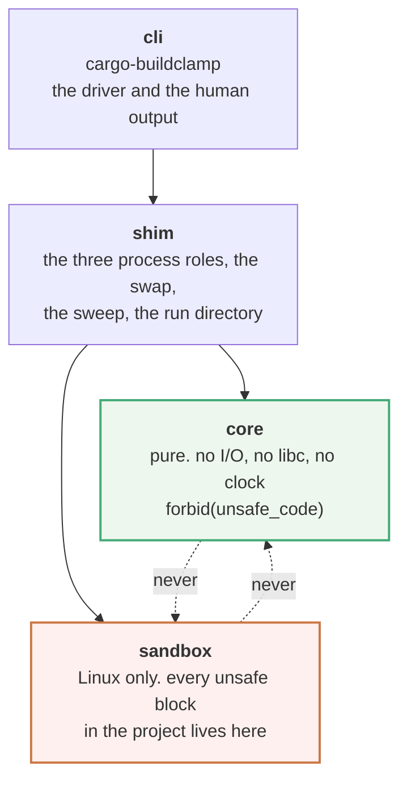
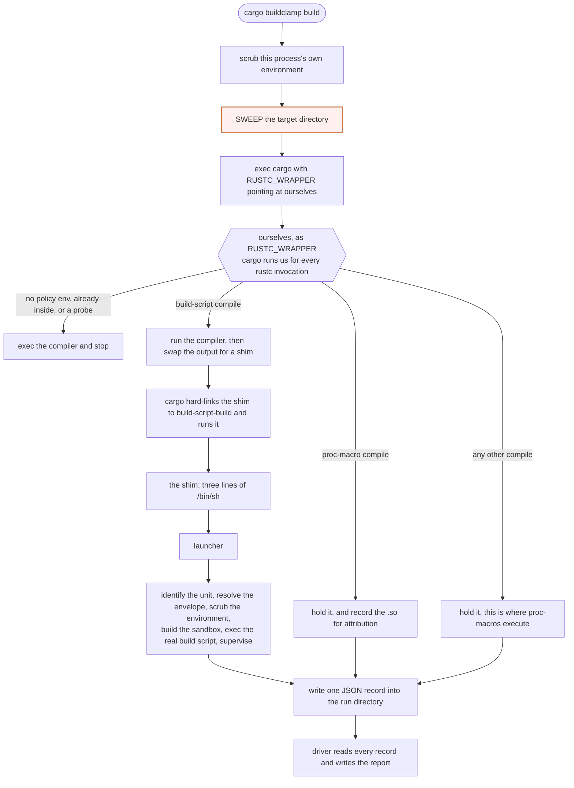
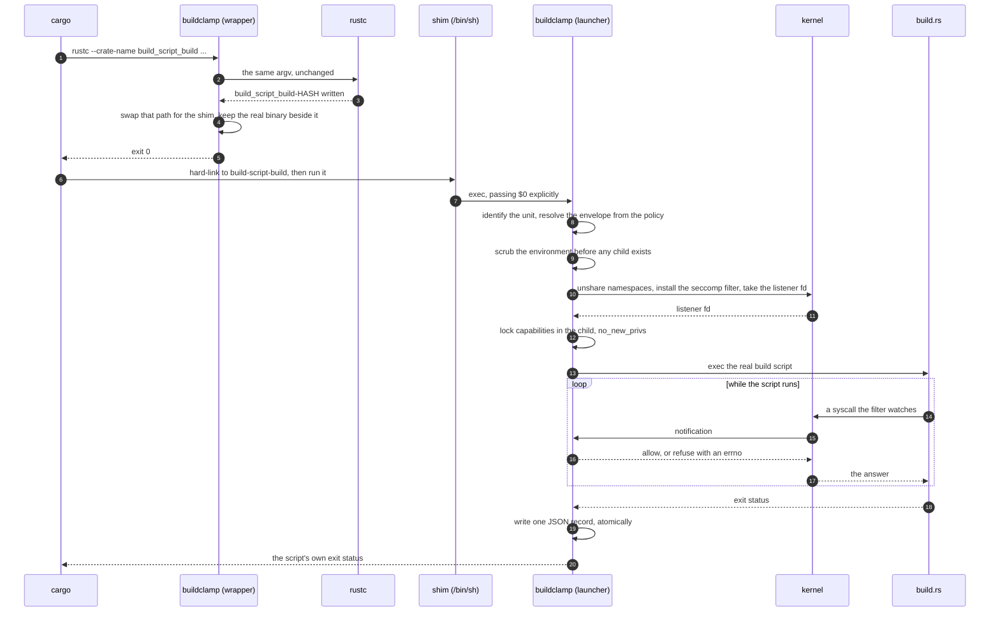
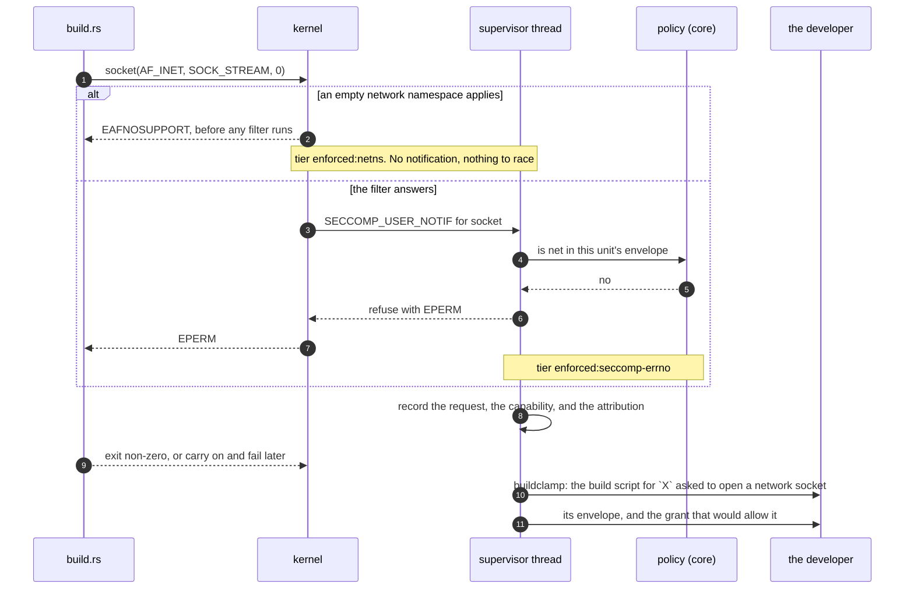

# Architecture

Why the parts are shaped the way they are. The API docs say what each function does; this
says which decisions are load-bearing and what breaks if you change them.

Everything here was measured against cargo 1.94.1 and Linux 6.18 before it was written.
Where a claim came from a measurement, the measurement is named.

---

## 1. The asymmetry everything follows from

> **A build that fails because a policy was too narrow costs a developer ten minutes. A
> build that reports success while enforcing nothing costs them their credentials.**

That is not symmetric, and it decides every fallback in this design. Consequences, each of
which shows up as a mechanism below:

| consequence | mechanism |
|---|---|
| never claim an enforcement you did not achieve | `Tier` is a variant carrying its mechanism; there is no boolean (§4) |
| a missing helper must not silently disable enforcement | in-process seccomp/Landlock/namespaces, no external binary (§4) |
| an unrecognised cargo command line must not fail the build | classify-or-pass-through, never guess (§3) |
| a policy error must surface before any unit runs | the whole policy is validated at parse time (§5) |
| a report that is short reads exactly like a clean one | one atomically-written file per unit; a corrupt one is an error (§6) |
| adoption must start with measurement | `observe` is documented first, `init` second, enforcement third (§7) |

## 2. Crate boundaries follow the arrow

The product is one arrow — *cargo spawns a unit → a policy decides → a kernel enforces →
a report says what happened* — and each segment is a crate:

The two dotted arrows are the load-bearing part: **`core` and `sandbox` do not know each
other exists.** They meet in `shim`. Nothing enforces that but the manifests, so the
manifests are where to look when reviewing whether it still holds.

**`core` is pure** — no I/O, no `libc`, no cargo, no clock, `#![forbid(unsafe_code)]`. A
wrong answer here is the only way a build unit can run under rules nobody chose, so the
surface must be auditable line by line and `cargo test -p buildclamp-core` must exercise
all of it with no kernel features in the build. That is not a hypothetical requirement:
**this project's own CI host has no Landlock at all**, and every policy decision is still
fully tested there.

**`sandbox` is handed a command and an envelope** and knows nothing about cargo. Every
`unsafe` block in the project lives here, and every other crate carries
`#![forbid(unsafe_code)]` so the confinement is a compiler check rather than a convention —
which is also what makes it a scope an auditor can be quoted against. The dependency
direction is what stops policy decisions leaking into the enforcement layer, where they
could not be tested without privileges.
[`crates/sandbox/INTERNALS.md`](crates/sandbox/INTERNALS.md) is the guide to the inside of
it: the orderings that are load-bearing, and what breaks when each is changed.

**`shim` owns everything cargo-specific**: where rustc writes a compiled build script,
what cargo hard-links it to, that `OUT_DIR`'s hash is not the compile directory's hash.
When cargo changes, this is the crate that changes.

## 3. Interception

The sweep is coloured because it is the step whose absence is silent. Without it the tool
reports success while enforcing nothing on most real repositories, for the reason below.

### Three measured facts this rests on

**A build-script compile is recognisable only from the whole argv.** Under `cargo clippy`,
cargo also sets `RUSTC_WORKSPACE_WRAPPER`, and the *workspace's own* build script arrives
as `<us> clippy-driver <rustc> <args…>` while the five dependency build scripts arrive
with `argv[1] = rustc`. A classifier keyed on the compiler's basename would have skipped
precisely the unit a developer most wants held. Measured; there is a table test.

**`OUT_DIR`'s hash is not the compile directory's hash.** The shim and the real binary
live in `build/<pkg>-<hashA>/`; the script runs with `OUT_DIR=build/<pkg>-<hashB>/out`.
The launcher reads `OUT_DIR` from its environment at run time and never derives it.

**`RUSTC_WRAPPER` is NOT part of any fingerprint, and this is the most important fact in
the document.** An earlier draft of this design assumed the opposite — that turning
buildclamp on dirties every unit and forces a rebuild, so every build script passes
through the wrapper. An adversarial review reproduced the truth on cargo 1.94.1: a plain
`cargo build` followed by `RUSTC_WRAPPER=… cargo build -v` reports `Fresh` for everything,
and the wrapper is invoked only for `-vV` and the `--print` probe. Cargo excludes the
wrapper deliberately, so a build cache stays shareable between people who use `sccache`
and people who do not.

The consequence is the worst failure this tool can have. **Any target directory ever
populated by a plain build keeps its compiled build scripts un-shimmed forever** — a CI
cache restore, a colleague's build, rust-analyzer compiling build scripts in the
background the moment a dependency was added. Cargo re-*runs* them whenever it decides
the run is dirty, and those runs execute the plain binary: no sandbox, no scrub, no
record, and a report saying the build was clean.

So the driver **sweeps** the target directory before exec'ing cargo: it walks every
`.../build/<pkg>-<hash>/`, shims any compiled build script that is not shimmed yet, and
re-creates the `build-script-build` hard link, because cargo will not re-link a Fresh
unit either. `unhook` is the exact inverse, and the report carries how many units were
swept rather than intercepted.

The silver lining is real and worth stating: because the wrapper is not in the
fingerprint, alternating between `cargo build` and `cargo buildclamp build` costs **no
rebuild at all**, which is far better than the rebuild storm the original design assumed.
The sweep is what makes that safe rather than dangerous.

**Cargo hard-links the compiled build script, and re-links it after every rebuild.** The
linker never truncates in place — measured with `strace` on GNU ld 2.42: `unlink`, write a
temp with `O_EXCL`, `rename` — so the output always gets a fresh inode and cargo's hard
link would be stale unless cargo re-created it. It does. **This design depends on that
cargo behaviour**, and saying so is the difference between a documented dependency and a
coincidence.

### Why the shim is a shell script

Not a symlink and not a hard link to our binary:

* **A later plain `cargo build` costs nothing.** The shim tests one environment variable
  and execs the real binary.
* **An uninstalled buildclamp degrades to transparent, never to a broken build.** The
  shim checks the binary is executable first. A test executes a shim with the launcher
  missing and asserts the real build script runs.

Three effective lines, so a reviewer who does not trust buildclamp can audit what cargo
executes in ten seconds. That readability is the point: this file is the thing standing
between cargo and a third party's code.

### Passthrough, and why each rule exists

| condition | reason |
|---|---|
| no `BUILDCLAMP_POLICY` | a stray `RUSTC_WRAPPER` in a shell must not mutate target directories. Costs nothing: changing the wrapper already changes every fingerprint and forces a rebuild |
| `BUILDCLAMP_INSIDE` set | the filter and namespaces are already inherited; **only one `NEW_LISTENER` seccomp filter is permitted per task**; and a read-only `/proc` makes a nested user namespace's `uid_map` unwritable. Any one of the three is sufficient |
| a probe | `--print`, `-vV`, rustc reading stdin. No crate, no output, several per build |
| a build-script compile whose output path we could not recover | failing the build because we did not recognise a command line is how a wrapper gets uninstalled; guessing a path is how a target directory gets corrupted |

### The hold path, step by step

The write path of this tool: one build script, from cargo deciding to run it to a record
on disk. `sh` is the three-line shim, and the second appearance of `buildclamp` is the
same binary in a different role.

The ordering in steps 9 to 12 is not stylistic. Each of those four failed loudly when it
was in the wrong place, and §4 says how.

## 4. Enforcement, and the ladder

Per capability, buildclamp uses the strongest mechanism this host actually has, probes for
it at runtime rather than inferring it from a kernel version, and **records which one
applied**.

| capability | preferred | fallback | last resort |
|---|---|---|---|
| network | `enforced:netns` — an empty network namespace | `enforced:seccomp-errno` — `socket(AF_INET…)` returns `EPERM` | `none` |
| filesystem | `enforced:landlock-vN` — a per-path ruleset the unit applies to itself | `enforced:mountns-ro` — read-only root, writable binds | `advisory:seccomp-notify` |
| environment | `enforced:scrub+userns` — scrubbed, plus a child user namespace, which fails `ptrace_may_access` against the parent's, so `/proc/<pid>/environ` is `EPERM` | `advisory:scrub` — scrubbed, but a same-uid process's environ is still readable | `advisory:scrub` |
| exec | `enforced:seccomp-notify-record` — recorded, never refused | `enforced:seccomp-notify-record` | `none` — without seccomp notification exec cannot even be recorded |

That row used to say `enforced:pidns`, and it was crediting the wrong namespace. Unshare
each flag on its own and attempt the read: with `CLONE_NEWPID` the environment of a
same-uid process still comes back in full, and with `CLONE_NEWUSER` the open returns
`EPERM`. `CLONE_NEWPID` additionally does not apply to the unit at all — it sets
`pid_for_children`, so it moves the next process *forked*, and the child unshares and then
`execve`s with no fork in between. The PID namespace is still requested, and what it buys
is that processes the unit spawns cannot enumerate the host's; the tier no longer claims
it buys anything else.

**`advisory` is a different word from `enforced` and the type system enforces the
distinction.** A `SECCOMP_USER_NOTIF_FLAG_CONTINUE` response means the kernel re-reads the
argument after the supervisor answers, so a path decision made that way is racy by
construction. It is good enough to see what a build does and not good enough to call
enforcement, and `--require-enforced` exists so CI can refuse a run that only got that far.

### The capability lock is not optional

A read-only root inside a user namespace is **decorative** unless the child also loses the
capabilities to undo it. With the namespaces set up and nothing else, a spike child ran
`mount -o remount,bind,rw /` and wrote to `/root`. So, after the mounts and before
`execve`: securebits with every `*_LOCKED` bit, drop the whole bounding set, clear
ambient, `capset` to zero, `PR_SET_NO_NEW_PRIVS`. Verified afterwards: the remount is
`EPERM`, and a nested user namespace inherits the read-only flags through `lock_mnt_tree`.

### The ordering rules, each of which failed loudly when broken

1. **`uid_map` and `gid_map` before any mount change.** procfs writes take
   `mnt_want_write`; once `/proc` is read-only the write is `EROFS`.
2. **Capture uid and gid in the parent, before the fork.** After
   `unshare(CLONE_NEWUSER)` and before the map exists, `getuid()` returns the overflow uid.
3. **`chdir` to the original cwd after `pivot_root`.** The kernel rewrites cwd only for
   processes whose cwd *was* the old root. Cargo runs build scripts with cwd set to the
   manifest directory, so this is every unit, not a corner case.
4. **The supervisor thread must be blocked in `recvmsg` before `Command::spawn`.** The
   child's own first `execve` is notified, and `spawn` blocks until exec completes — start
   the supervisor afterwards and the whole thing deadlocks on the first unit.

### The temporary directory is private, not `/tmp`

A tmpfs over `/tmp` hides whatever was already there, including the build's own files when
the target directory happens to live under `/tmp` — measured. And granting the shared
`/tmp` gives two otherwise-isolated units a channel. So each unit gets a private directory
under its `OUT_DIR` with `TMPDIR` pointing at it. It cannot simply be denied: `cc` fails
hard without a writable temporary directory.

### What a refusal actually looks like

The read path: one ungranted request, from the syscall to the sentence a developer sees.
Cargo prints a build script's stderr only when the unit fails, so everything below has to
land in those few lines.

In observe mode the same path runs to the same recording and the answer at step 6 is
**allow**, with the outcome stored as *would be ungranted*. That is the whole difference,
and it matters: an observe run that built the empty namespace would fail connections with
a different errno than the developer's real machine produces, and a policy generated from
that describes a build nobody has.

## 5. The policy

`buildclamp.toml` is validated **completely at parse time**, before any unit runs. Every
error it can produce is one a person fixes by editing the file, and none can first appear
halfway through a build.

* **`why` is required and non-empty on every grant.** The `cargo-vet` ergonomic applied to
  capabilities instead of review: the cost of widening an envelope is that somebody writes
  a sentence a colleague reads in a pull request.
* **Ambiguity is refused, not resolved by file order.** Two grants matching the same
  version is a policy whose meaning depends on a merge conflict.
* **A grant replaces the defaults rather than adding to them**, so a reader sees a unit's
  whole envelope in one place instead of composing it mentally.
* **Unknown fields are rejected**, so `capabilties = [...]` is an error rather than a
  silent "no capabilities".
* **A version requirement never applies to a version semver could not parse.** Git and
  path dependencies carry arbitrary strings, and a grant that applied to one would be
  widening an envelope by accident.

## 6. The report

Units run concurrently under `cargo --jobs N`, each in a process that exits before the
next starts. There is no shared memory and no supervisor spanning the build, so each unit
writes **one JSON file**, to a temporary name and then renamed into place.

Never one shared file: several processes appending is a corruption waiting for a busy
build, and the failure mode would be a report that is silently short — the worst possible
failure for an audit artefact, because **a missing unit reads exactly like a clean one**.
For the same reason a record that does not parse is a hard error rather than a skip.

**Identity is not `name@version`.** One compiled build script is executed more than once
per build whenever a crate is both a normal and a build dependency under `--target` —
`libc`, `cfg-if` and `proc-macro2` in practically every cross build. Measured on cargo
1.94.1: the same binary runs twice, interleaved by cargo's scheduler, with identical
`CARGO_PKG_NAME`, `CARGO_PKG_VERSION`, `CARGO_MANIFEST_DIR` and even `TARGET`,
distinguished **only** by `OUT_DIR`. Keying a record on name and version alone means the
second write erases the first, and if the erased one is the run that reached the network
the report says the unit was clean. So each record carries an `instance` — the basename of
`OUT_DIR`'s parent, which cargo guarantees unique per run and which is deterministic
rather than a pid, so two runs of the same build still produce comparable reports.

Records are sorted by identity and instance on read, so two runs of the same build produce
byte-comparable reports. Diffing two reports is how capability drift is found, and an
order that depended on `readdir` would make every diff noise.

## 7. The adoption path is a design constraint

`observe` → `init` → `build` is documented in that order because a default-deny policy
that breaks common crates on the first run is uninstalled the same afternoon. Two
properties follow, and both are tested:

* the `benign` fixture — the shape shared by `cc`, `bindgen`, `pkg-config` and
  `prost-build` — must produce **zero** ungranted requests under the defaults;
* `init` from an observe run must produce a policy that makes the same build pass, with
  every generated grant `reviewed = false`.

## 8. What v0 does not attempt, and why

* **macOS `sandbox-exec` and Windows AppContainer.** Cross-platform sandbox maintenance is
  permanent engineering debt; Linux is where CI runs and where the primitives are best.
* **WebAssembly execution of build scripts**, which is the direction the accepted-but-
  unimplemented compiler-team MCP #475 prefers. It is a rewrite, not a wrapper, and the
  `-Zsandbox` experiment that tried it stalled on a real problem: `wasm32-wasip1` has no
  process spawning, and build scripts must spawn `pkg-config` and C compilers.
* **An enforced network destination allowlist.** It needs a proxy or firewall rules inside
  the namespace. The field exists, is recorded, and says everywhere it appears that it is
  not enforced.
* **Read restrictions.** Reads are unrestricted by default; a read-deny list for `~/.ssh`,
  `~/.aws` and browser profiles is the most valuable single addition and is not in v0.
* **Static reachability analysis.** `cargo-acl` does this well and buildclamp does not do
  it at all. They compose.
